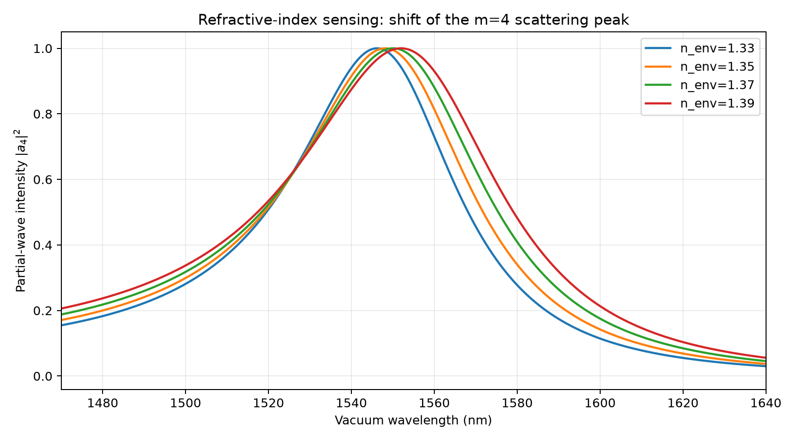
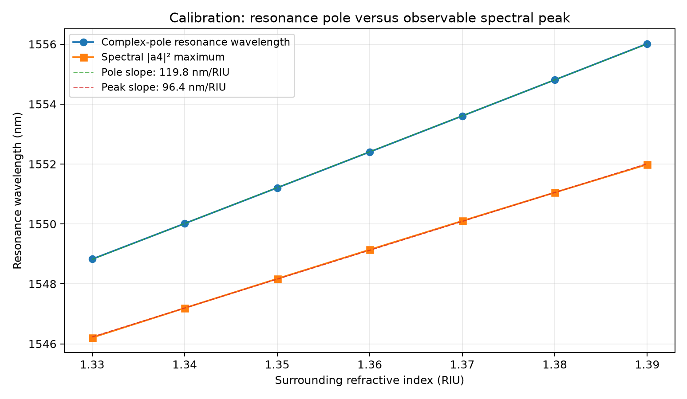
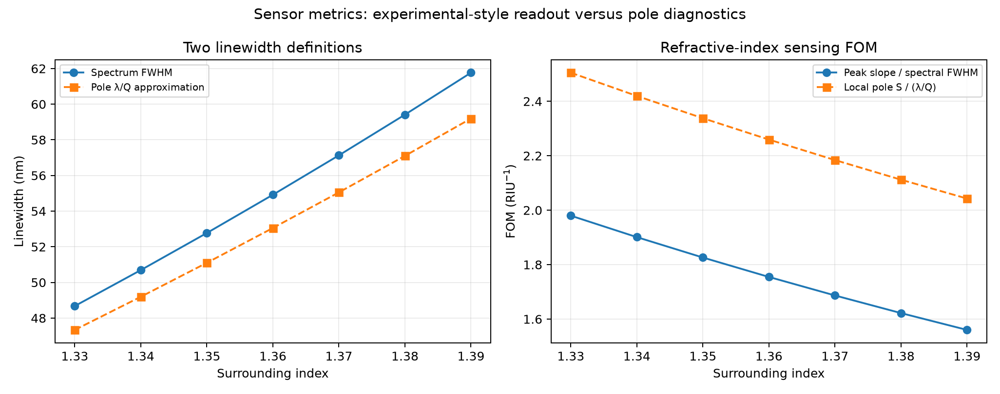
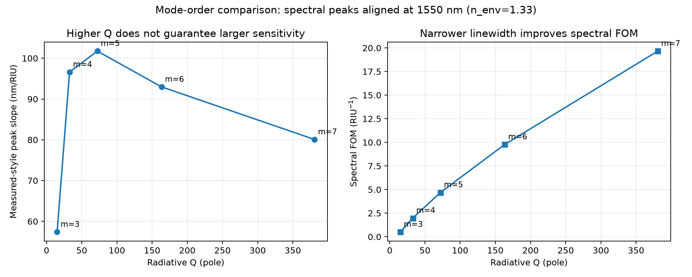
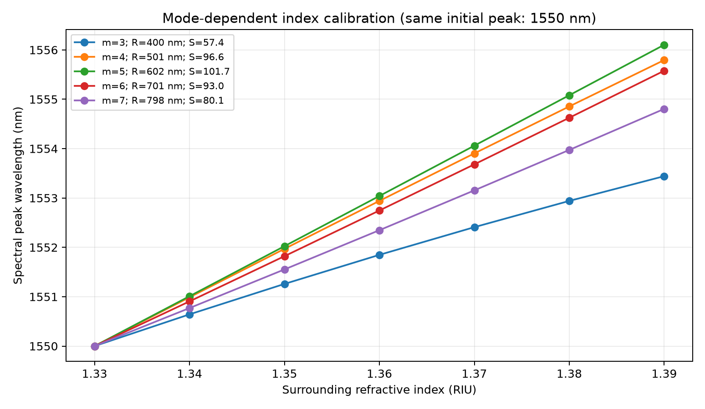
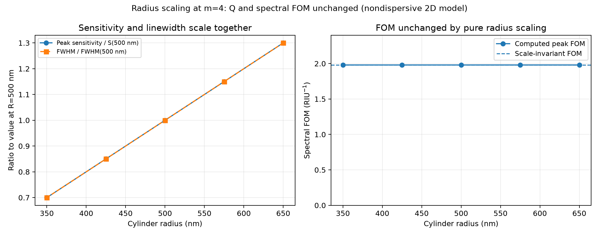
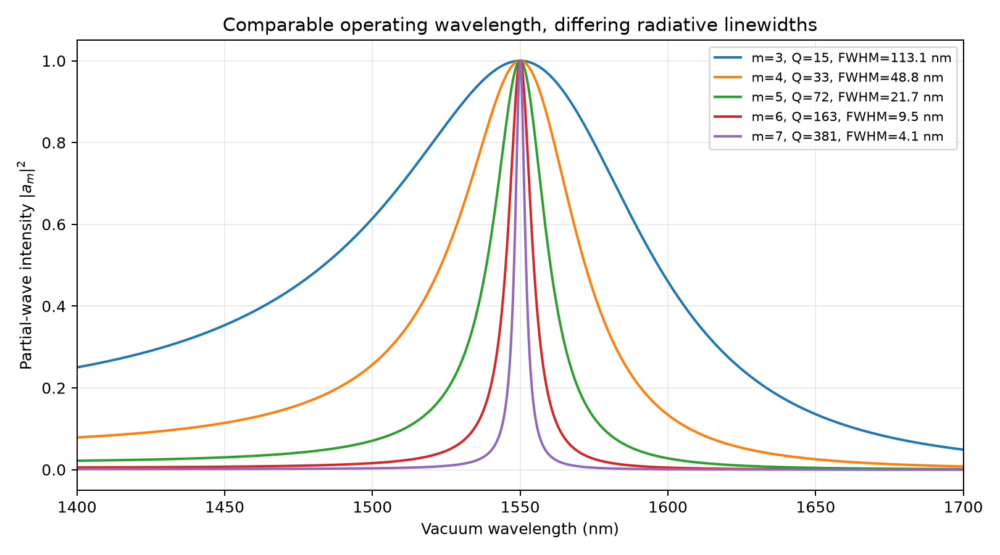

# Resonance-Pole Refractive-Index Sensor | Python

A reproducible **computational photonics sensing benchmark** based on exact 2D Mie scattering from an infinite circular dielectric cylinder. It follows the complex resonant poles as the **surrounding refractive index changes** and compares pole-based resonance shifts with directly observed scattering-spectrum peaks.

**What is measured in this model?** The shift in a selected optical resonance when the environment index changes. This is the core optical mechanism of a refractometric sensor.

## Selected figures

### Resonance shifts with surrounding index



### Pole versus directly observable spectral calibration



### Resonance linewidth and figure of merit



## Physical model

- Geometry: infinitely long circular homogeneous dielectric cylinder of radius **500 nm**
- Cylinder index: **n_core = 3.0**, real and nondispersive
- Infinite liquid-like environment: **n_env = 1.33–1.39**, increments 0.01
- Excitation: 2D out-of-plane electric field $E_z$ (often called TM$_z$), nonmagnetic media
- Scattering basis: cylindrical Bessel functions inside and incident region, outgoing Hankel functions outside
- Main sensing channel: **m = 4**, approximately 1550 nm
- Additional channels: m = 3 and m = 5 for comparison
- Time dependence: $e^{-i\omega t}$, so decaying outgoing resonances satisfy $\mathrm{Im}(k_0R)<0$

For the dimensionless vacuum wavenumber $x=k_0R$, the exact partial-wave scattering amplitude is

$$
a_m(x)=\frac{N_m(x)}{D_m(x)}
$$

where

$$
\begin{aligned}
N_m(x) &= n_c J'_m(n_c x)J_m(n_e x)-n_e J'_m(n_e x)J_m(n_c x),\\
D_m(x) &= n_e J_m(n_c x)H_m^{(1)\prime}(n_e x)-n_c J'_m(n_c x)H_m^{(1)}(n_e x).
\end{aligned}
$$

$J_m$ is a Bessel function, $H_m^{(1)}$ is the outgoing Hankel function, primes denote differentiation with respect to the function argument, $n_c$ the cylinder index, and $n_e$ the surrounding index. Complex outgoing resonance poles solve $D_m(x_p,n_e)=0$.

The resonance frequency, radiative Q and approximate wavelength linewidth are

$$
\lambda_p=\frac{2\pi R}{\mathrm{Re}(x_p)},\qquad
Q_p=\frac{\mathrm{Re}(x_p)}{-2\mathrm{Im}(x_p)},\qquad
\Delta\lambda_{p,\mathrm{approx}}=\frac{\lambda_p}{Q_p}.
$$

We also extract the **spectral peak wavelength and actual half-maximum linewidth** of $|a_4|^2$. Because the spectrum can be asymmetric, the pole wavelength and the spectral-peak wavelength are compared separately rather than treated as identical.

## Sensor metrics

The bulk refractive-index sensitivity is

$$
S=\frac{\mathrm d\lambda_\mathrm{res}}{\mathrm dn_e}\quad(\mathrm{nm/RIU})
$$

and the spectral figure of merit is $\mathrm{FOM}=S/\mathrm{FWHM}$ in RIU$^{-1}$. An independent local derivative of a tracked resonance is evaluated by implicit differentiation:

$$
\frac{\mathrm d x_p}{\mathrm dn_e}
=-\frac{\partial_{n_e} D_m(x_p,n_e)}{\partial_x D_m(x_p,n_e)}.
$$

## Reproduced numerical results

At $n_e=1.33$, for $m=4$, cylinder $n_c=3$, $R=500$ nm:

| Metric | Value |
|---|---:|
| Pole-based wavelength sensitivity, linear fit over $n_e=1.33\ldots1.39$ | **119.84 nm/RIU** |
| Scattering-peak sensitivity, linear fit over $n_e=1.33\ldots1.39$ | **96.37 nm/RIU** |
| Radiative quality factor at $n_e=1.33$ | **32.72** |
| Scattering peak FWHM at $n_e=1.33$ | **48.67 nm** |
| Peak-based spectral FOM at $n_e=1.33$ | **1.98 RIU$^{-1}$** |

These are **simulated benchmark values**, not experimental sensor measurements. Spectral-peak sensitivity is the slope over the entire specified index interval; local pole sensitivity uses the derivative at each index. The FOM is a spectral metric; detection limit also depends on experimental noise and resolution and is not claimed here.

## Project structure

```text
Resonance_Pole_Refractive_Index_Sensor/
├── README.md
├── mie_sensor.py                  # Mie coefficient, complex roots, Q, sensitivity, spectra
├── run_sensor.py                  # Original calibration and five figures
├── sensor_design.py               # Angular-mode and radius comparative analysis
├── run_design_comparison.py       # New design study, four figures and three CSVs
├── requirements.txt
├── tests/
│   ├── test_sensor.py             # Original physics and sensing tests
│   └── test_design_comparison.py  # Tradeoff and radius scale-invariance tests
└── outputs/
    ├── 01_index_dependent_spectra.png
    ├── 02_sensor_calibration.png
    ├── 03_resonance_pole_trajectories.png
    ├── 04_q_sensitivity_tradeoff.png
    ├── 05_linewidth_and_fom.png
    ├── sensor_pole_metrics.csv
    ├── sensor_spectra.csv
    ├── sensor_summary.csv
    ├── 06_mode_order_q_sensitivity_fom.png
    ├── 07_mode_order_calibration.png
    ├── 08_radius_scaling_invariance.png
    ├── 09_mode_order_spectra.png
    ├── mode_design_metrics.csv
    ├── mode_design_calibration.csv
    └── radius_scaling_metrics.csv
```

## Numerical verification

The tests verify that a uniform medium has zero scattering, that the lossless partial-wave scattering matrix obeys $|1+2a_m|=1$, that tracked poles satisfy the outgoing boundary condition, and that the implicit pole sensitivity matches a finite-difference pole shift. The spectral linewidth is extracted from the Mie spectrum, not inferred from $Q$ alone.


## Extension: Does a higher-Q resonance make a better RI sensor?

The comparative study tests **azimuthal orders m=3 through m=7** in the same
lossless 2D cylinder scattering framework. Each mode uses a **different radius**
chosen so that its real-axis partial-wave intensity peak is at **1550 nm when
n_env=1.33**, making the readout wavelength comparable across modes. Core index
is 3.0 for all modes. Seven surrounding-index values from 1.33 to 1.39 are used
for each spectral-peak calibration fit.





| Angular mode | Radius (nm) | Q at 1.33 | Peak S (nm/RIU) | Spectral FWHM (nm) | FOM (RIU^-1) |
|---:|---:|---:|---:|---:|---:|
| 3 | 399.82 | 15.04 | 57.40 | 113.14 | 0.51 |
| 4 | 501.23 | 32.72 | 96.60 | 48.79 | 1.98 |
| 5 | 601.78 | 72.17 | 101.75 | 21.67 | 4.70 |
| 6 | 700.80 | 163.39 | 92.98 | 9.51 | 9.78 |
| 7 | 798.19 | 380.79 | 80.08 | 4.07 | 19.66 |

**Interpretation:** in this mode family, increasing Q is **not equivalent**
to increasing raw spectral-peak sensitivity in nm/RIU. The sensitivity reaches
its largest value around m=5, whereas the spectral FOM continues increasing
because the resonances narrow sharply. FOM is computed as the fitted slope of
the selected-channel scattering peak versus ambient RI divided by its FWHM at
n_env=1.33. The selected partial wave is a mode-resolved readout, rather than
the total collected far-field signal of a specific instrument.

### Radius sweep and Maxwell scale invariance

Keeping **m=4** and all refractive indices fixed, we compare radii
350, 425, 500, 575, and 650 nm. The corresponding resonance wavelengths,
peak sensitivity in nm/RIU, and FWHM all scale linearly with R. **Q and FOM
remain constant**: an exact consequence of using nondispersive, lossless
materials and an otherwise self-similar Maxwell problem. Changing radius alone
therefore does not improve this idealized spectral FOM.





**Files for this extension:** `sensor_design.py`,
`run_design_comparison.py`, `tests/test_design_comparison.py`; data tables
`mode_design_metrics.csv`, `mode_design_calibration.csv`, and
`radius_scaling_metrics.csv` in `outputs/`.

Run the extension independently:

```powershell
python run_design_comparison.py
python -m unittest discover -s tests -v
```

The study compares modeled resonances, not fabricated sensors, and cannot
establish an experimental detection limit without noise, collection geometry,
material dispersion, absorption, and radiative/experimental coupling.

## Related literature

- [On the performance quantification of resonant refractive index sensors](https://pmc.ncbi.nlm.nih.gov/articles/PMC3071988/): refractometric sensitivity, resolution, linewidth and practical sensor metrics.
- [Hybridization of surface plasmons and photonic crystal resonators for high-sensitivity and high-resolution sensing applications](https://www.nature.com/articles/s41598-022-25980-y): mode overlap, bulk sensitivity and FOM.

## Context and use

This project extends the previous **optical-resonance-benchmarks** portfolio from the analysis of pole expansions to the concrete application of refractive-index sensing. It is a deliberately transparent computational model of an infinite 2D resonator; it is not a measured device or a finite-height fabricated sensor.
